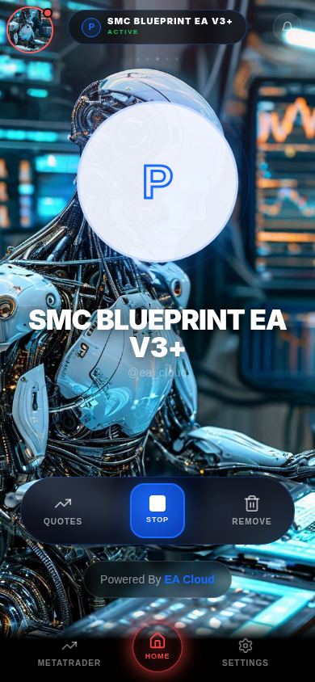
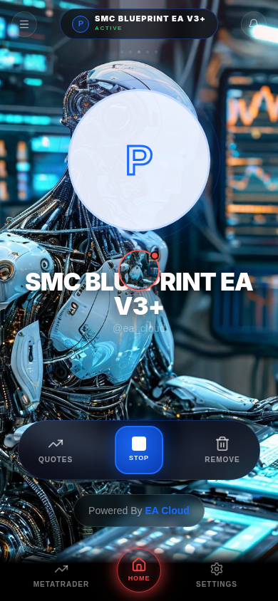

# Freely draggable floating robot trigger

The bottom-right circular robot is the shared `TradingActivityMonitor` trigger. It opens the live trading activity panel. This change modifies only its positioning and pointer gesture behavior; main bot portraits, shape choices, themes, artwork, trading handlers and navigation are untouched.

`useFloatingRobot` captures the primary pointer and distinguishes taps from dragging with a 6 CSS-pixel movement threshold. Pointer movement updates a GPU transform on animation frames, without an edge snap or return animation. Drop coordinates are saved under `ea-cloud:floating-robot-position` in localStorage. The existing app-viewport overlay remains independent of Home's scrolling content. Pointer capture handles movement beyond the button and pointer cancellation. Drag releases suppress their compatibility click; normal taps, mouse clicks and keyboard activation keep the existing panel action.

Positions are clamped against the visible application rectangle intersected with the visual viewport, accounting for button dimensions and mobile safe-area insets. ResizeObserver, window resize and visualViewport events keep the complete circle accessible after resizing, keyboard viewport changes and orientation changes. Storage errors do not disable dragging; corrupt/non-finite saved values fall back to the original position. Only the trigger uses touch-action:none; other content retains its existing scrolling behavior. Image dragging and mobile image callouts are disabled only on this button.

## Production-build browser evidence

Built the real combined Cloudflare Pages output, served it locally at `/ea-app/`, and exercised the actual shared trigger in Chromium with isolated API fixtures. No live trading requests were made.

- 390×844 and 320×568: real browser CDP touch-start/move/end gestures.
- 1280×900: real mouse-down/move/up input in the centered 430px app viewport.
- Each moved bottom-right → top-left → freely placed center. Coordinates remained unchanged after release and reload. No drag opened the activity panel.
- Normal tap/click and keyboard Enter opened the original activity panel; closing it returned focus to the trigger.
- Regular, S2tone_ and Matrix switches, Settings/Home/MetaTrader navigation and Home content scrolling retained exactly the same floating coordinates.
- Drags toward all four out-of-bounds corners retained the complete circle inside the app. Simulated 20px left/25px top safe-area insets were respected.
- Resizing to landscape/smaller dimensions clamped the position safely and saved it. Closing the application tab and opening a new one in the same browser profile restored the saved coordinates.





[Recorded measurements](browser-results.json)

TypeScript checking, combined production builds and the existing activity-monitor UI regression test passed. No application dependency was added.

Repeat against a local production preview on port 5179:

```sh
APP_ORIGIN=http://127.0.0.1:5179/ea-app/ CHROMIUM_PATH=/usr/bin/chromium node scripts/tests/floating-robot.browser.mjs
node scripts/tests/activity-monitor-ui.test.mjs
```

Set PLAYWRIGHT_MODULE to the installed Playwright index.mjs path when outside the repository. Captures default to work/floating-robot/.

These are desktop and emulated mobile Chromium tests, not claims of physical iOS/Android hardware testing. No production deployment was performed; live website rollout is not verified by these local production-artifact captures.
