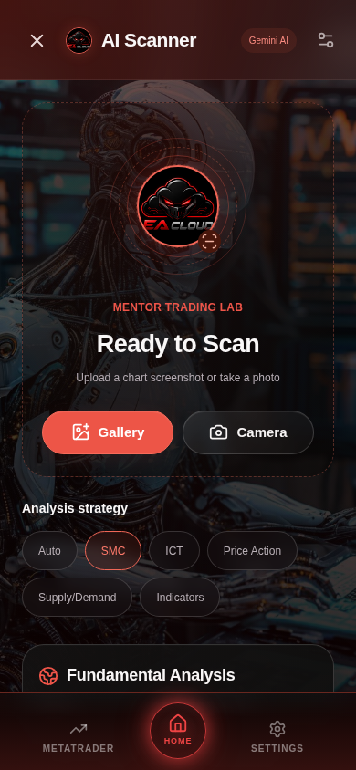
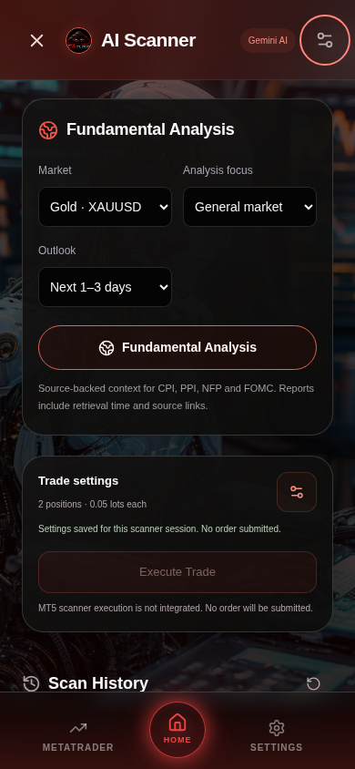
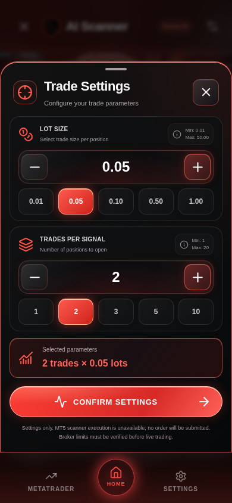
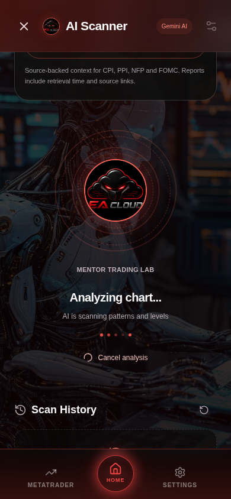
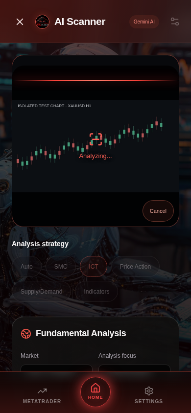
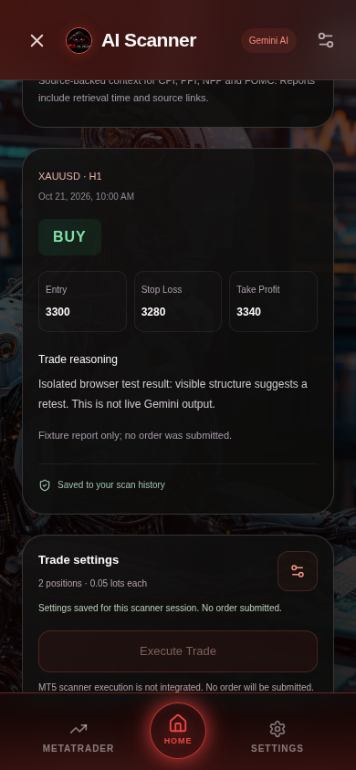

# EA Cloud AI Scanner — reference batches 1–3

Development branch: `feat/gemini-chart-scanner`, based on main after the MT5 redesign was merged. This is the existing client app and API, not a separate project. This revision follows the supplied ready/upload, fundamental-analysis, Trade Settings, pending-analysis, uploaded-chart overlay and signal-result screenshots. Result-screen details can be refined against later reference batches. Nothing has been deployed or migrated.

## Actual client UI

- Black/red translucent header, EA Cloud badge and atmospheric scan area over `useApp().bgImageUrl`, preserving the linked mentor's existing background/name. The reference character art is not substituted for mentor branding. The existing EA Cloud logo is used because AppContext currently exposes no separate mentor avatar URL.
- Real Gallery chooser and rear-camera capture hint. JPEG, PNG and WebP only; HEIC users get a conversion message. Inputs are bounded to 10 MB and 40 megapixels; each selected image is prepared as JPEG at maximum 1600 px and 2 MB. Object URLs are revoked and bitmaps closed. No bulk image processing or new image service.
- Selecting an image only prepares a local preview. **Analyse chart** explicitly sends it to Gemini through the authenticated API. The UI explains this next to the action. Original screenshots are not retained in app storage or the database.
- Auto, SMC, ICT, Price Action, Supply/Demand and Indicators controls feed the analysis request. Scan animations run while a request is pending, respect reduced motion, and support cancellation/close cleanup. There is no fake percentage, hardcoded BUY result or invented credit balance.
- While chart analysis is pending, the uploaded object URL remains visible in its own rounded frame above strategies/fundamentals, with a red moving scan line, scan reticle, “Analyzing...” and local Cancel. The same preview survives completion/cancellation. A chart request initially scrolls to this image; the companion centered progress view remains below Fundamentals. Reduced motion makes both scan line and rings/dots static. No image rewriting, invented levels or generated screenshots are painted over the uploaded image.
- Pending analysis uses a centered upright EA Cloud mark, restrained rotating red rings and five pulsing dots, mentor name, exact “Analyzing chart...” and “AI is scanning patterns and levels” text. Fundamentals has its own truthful research text. This state appears below the fundamentals panel only while a real analysis request is pending; cancellation remains available, and reduced motion disables rings/dots. The settings summary is hidden while analysing so history follows directly below.
- A compact red-edged glass chart-result card with symbol/timeframe/strategy, persisted timestamp, BUY/SELL/NO TRADE signal tile, Entry/Take Profit/Stop Loss tiles, AI Analysis Report and optional evidence pills. BUY uses green, SELL red, NO TRADE muted amber. Confidence explicitly says **Not calibrated / No win-rate estimate** with an unfilled dash ring; no 87%, “High Probability” claim, invented progress or calibrated confidence is supplied. **Report saved** reflects only a successful persisted report/history read, not broker verification. The green Execute Trade control remains disabled with an adjacent unavailable message.
- Prices are formatted for the browser locale without dropping forex precision or rounding tiny valid prices to zero. NO TRADE levels stay blank (em dash). Optional `evidenceTags` allow at most four distinct known labels supplied by Gemini; no pills are invented from reasoning text. Legacy records without tags still render, and unknown/duplicate/excess tags or unsolicited confidence fields fail validation. This optional JSON report field requires no additional schema migration; the original history-table setup is still required.
- Typed BUY / SELL / NO TRADE results, entry/SL/TP, reasoning and limitations. Unclear charts should yield NO TRADE; invalid/inverted/missing levels are rejected by server validation. Results are suggestions from a screenshot, not live quotes or guarantees.
- Fundamentals controls: XAUUSD/EURUSD/GBPUSD/USDJPY/US100/US30, General market/CPI/PPI/NFP/FOMC, Intraday/Next 1–3 days/This week. Gemini Google Search grounding supplies source links and retrieval time. Reports without grounding supports and HTTPS source links fail rather than inventing current news. This is a researched snapshot, not a streaming economic calendar. The model is instructed to distinguish actual/forecast/previous/unreleased figures and state missing dates/data.
- Paginated, client-scoped PostgreSQL report history, refresh/reopen and explicit unavailable states. Empty history is shown only after a successful empty response. Images and credentials are not saved. An aborted request may already have reached Google or completed persistence; refreshing history reconciles reports the server completed before cancellation.
- A red glass Trade Settings bottom sheet with exact 0.01-lot steppers, manual decimal input and presets (0.01/0.05/0.10/0.50/1.00), preparation limits of 0.01–50.00 lots, whole positions from 1–20, count presets (1/2/3/5/10), and a live selected-parameters summary. Draft changes commit only through **Confirm settings**; close/backdrop/Escape discard the draft and restore focus. Values are held for this scanner session, not persisted to global trading controls. Underlying content is inert, the sheet traps focus and its body scrolls on small phones.
- **Confirm settings** is intentionally used instead of the reference’s “Confirm execution”: it performs no API write or order request. Actual **Execute Trade stays disabled**. Both UI and `/execute` endpoint explicitly state that scanner execution is not integrated and no order was sent. Scanner reports never enter mentor signal tables, the copy worker, webhooks or VPS execution.
- Existing MetaTrader/Home/Settings navigation is reused. Closing returns to the launcher; scanner navigation closes the modal and selects the requested tab. Keyboard focus is trapped/restored within the scanner.

## Server and contracts

- `lib/api-zod/src/scanner.ts` contains shared result/request validation and types; `scanner-options.ts` keeps frontend strategy constants independent of runtime Zod to avoid adding its bundle weight to the mobile app.
- `artifacts/api-server/src/lib/scanner-gemini.ts` calls the fixed HTTPS Gemini generateContent endpoint. The key goes in a server request header, never a URL, browser bundle or log. Server timeout is 55 seconds; client timeout 65 seconds. Provider errors and raw content are not logged. Aborted/truncated/blocked/invalid responses cannot become completed reports.
- `routes/scanner.ts` follows the existing client-session convention, checks the approved client plus a separate active, unexpired scanner subscription/admin grant, then scopes all report queries/inserts to that client. A caller-supplied clientId is ignored. Scanner endpoints do not change the app's existing authentication format or licensing flows.
- POST requests have an operational per-client limit of 12 requests/hour per API process. This is a memory-backed request limit, **not a durable paid-credit quota**; failures count as requests and the limit resets with the process. No quota is fabricated in the UI. Production-wide quotas would need separate persisted accounting/shared rate limiting.
- Multipart memory upload limit: one PNG/JPEG/WebP, 2 MB, one strategy field. MIME headers/magic bytes are checked before provider upload. The existing 256 KB JSON parser limit is preserved for unrelated routes.
- A history preflight fails before a provider call if the scanner table is unavailable. If report persistence fails after AI analysis, the API returns an explicit save error; it never claims the report was saved.

Routes under `/api/app/scanner`:

| Method | Path | Behaviour |
| --- | --- | --- |
| GET | `/status` | Gemini key configured flag; execution always unavailable |
| GET | `/history?page=1` | Up to 20 own reports and hasMore flag |
| POST | `/chart` | Multipart image + strategy, validate Gemini result, persist report |
| POST | `/fundamentals` | Validated market/focus/outlook, source-grounded report, persist |
| POST | `/execute` | Always 503; no order/queue side effect |

## Setup required before live use — not performed

1. Review and apply only [the additive scanner migration](migrations/20261021-scanner-reports.sql) to a staging PostgreSQL database first. It creates `scanner_reports` and its client/time index, touches no existing rows, and uses a cascading client foreign key so existing explicit client deletion is not blocked by report history. It is not invoked at startup. Do not run a schema reset, seed or force-push. The migration is intentionally not silently rerunnable: normal migration tracking should apply it once.
2. Configure `GEMINI_API_KEY` as a **server-only secret**. Also configure `GEMINI_SCANNER_MODEL` explicitly; select a currently available model supporting image input, JSON output and Google Search grounding. There is deliberately no assumed default: Google restricts older models and changes availability. Check the current [model lifecycle documentation](https://ai.google.dev/gemini-api/docs/deprecations) and intended project access. Never use a VITE-prefixed key. Verify model availability, provider permissions and billing/usage in the intended Google project. No Google project, paid service or secret was provisioned by this change.
3. Allow outbound HTTPS to `generativelanguage.googleapis.com` in the API host's network configuration. This Codex environment currently has neither that destination allowed nor a bound Gemini credential; **live Gemini inference/grounding has not been tested here**. No charts were sent to Google during development.
4. After review/approval, stage the API and existing combined Pages build, preserving API routing, mentor/R2 settings and all existing records. Verify scanner-entitled access, a real chart, source-grounded CPI/FOMC reports and history across reloads in staging. Physical iPhone/Android camera permissions and capture also need device smoke tests; automated checks use the real browser file chooser with isolated test images.
5. MT5 scanner execution remains a separate future integration. Require a client-owned saved report, authoritative live account verification, current quote/symbol/volume/stop checks, explicit user confirmation, idempotency and durable execution status. Never infer success from animation, a stored connected flag or HTTP 200, and never broadcast a client scan as a mentor signal.

The branch commit uses `[skip ci]` to suppress automatic Cloudflare preview deployment during visual review. No merge or deployment is authorized by these screenshots.

## Screenshots of the actual production UI

These captures run the real React build at 390 × 844 with isolated auth, dashboard, scanner/history and account socket fixtures. The robot image is the repository image supplied as that fixture mentor's upload. They are not generated artwork or live trading results.

| Ready screen | Fundamentals / history |
| --- | --- |
|  |  |

| Trade Settings — second batch | Pending analysis — second batch |
| --- | --- |
|  |  |

| Uploaded-chart scan overlay — third batch | Signal result — third batch |
| --- | --- |
|  |  |

[SELL fixture](previews/scanner/sell-fixture-mobile.png) · [NO TRADE fixture](previews/scanner/no-trade-fixture-mobile.png) · [Scrollable settings at 320 × 568](previews/scanner/trade-settings-small-mobile.png) · [Pending chart animation](previews/scanner/scanning-mobile.png) · [Report UI — explicitly labelled fixture, not live Gemini](previews/scanner/report-fixture-mobile.png) · [Unavailable service](previews/scanner/unavailable-mobile.png) · [320px phone](previews/scanner/small-mobile.png)

## Validation

- 42 unit tests passed: 1 price/locale/precision test, 3 lot/position validation/step tests, 8 Gemini/result/image/grounding/cancellation/tag-validation checks plus 30 existing MT5/mobile loading/Pages/background-storage/bootstrap tests.
- Isolated scanner HTTP route test passed with in-memory records and mocked query conditions/provider: approved/scanner-entitled access, expired scanner subscriptions, two known clients seeing only their own reports even with clientId injection, invalid requests, history-unavailable preflight before AI cost, report persistence and always-unavailable execution. This does **not** validate the migration against a real PostgreSQL server or replace staging tests.
- Production-browser suite passed: real Gallery/Camera chooser, capture hint, JPEG preparation, explicit request only after Analyse, strategy payload, animation, typed BUY/SELL/NO TRADE fixture rendering, optional AI tags and legacy untagged history, unavailable confidence with no percentages, preserved object URL/red scan overlay/local cancel, grounded fundamental fixture/source link, report reopening from history, unavailable/history error and retry, cancellation, disabled execution, settings presets/manual limits/confirm-without-API/cancel-draft/focus restoration, scrollable narrow settings sheet, reduced motion, 320px/mobile/desktop overflow and no runtime/unexpected console errors. No production AI, MT5 or database calls.
- TypeScript library build plus mobile, website and API checks passed. API production build and combined Pages website/mobile build with route verification passed.

Reproduce from repository root (installed dependencies required):

```sh
node --test --test-isolation=none scripts/tests/scanner-format.test.mjs scripts/tests/scanner-trade-settings.test.mjs scripts/tests/scanner.test.mjs scripts/tests/mt5-preview.test.mjs scripts/tests/mobile-loading.test.mjs scripts/tests/pages.test.mjs scripts/tests/background-storage.test.mjs scripts/tests/bootstrap.test.mjs
node --test --test-isolation=none scripts/tests/scanner-api.test.mjs
pnpm run typecheck
pnpm run build:pages
pnpm --filter @workspace/api-server build
```

The workspace pnpm automatic dependency check tries to reinstall existing modules/home-cache data. Builds here use `pnpm_config_verify_deps_before_run=false pnpm run build:pages`; TypeScript uses installed binaries directly. No dependency/lockfile changes are needed.

Serve the mobile production build with `BASE_PATH=/ea-app/` on both build and preview. Run `scripts/tests/scanner.browser.mjs` with `SCANNER_ORIGIN` set to that loopback origin and optional `PLAYWRIGHT_MODULE`/`CHROMIUM_PATH` paths. It refuses non-loopback hosts, isolates every API/account socket and blocks third-party requests. `SCANNER_SCREENSHOTS` selects capture output. Browser-result fixture reports explicitly identify themselves as fixtures in their reasoning.
