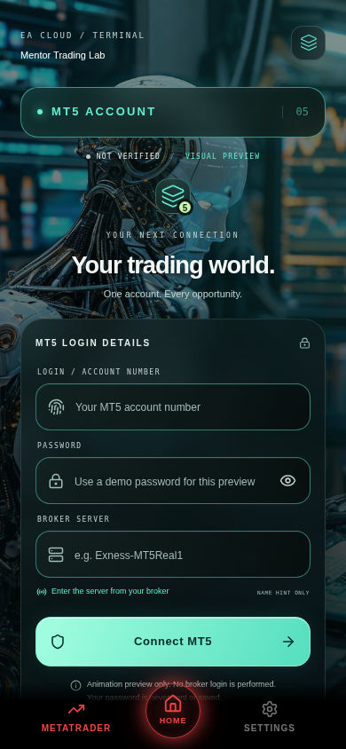
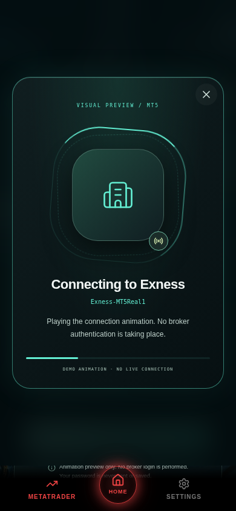
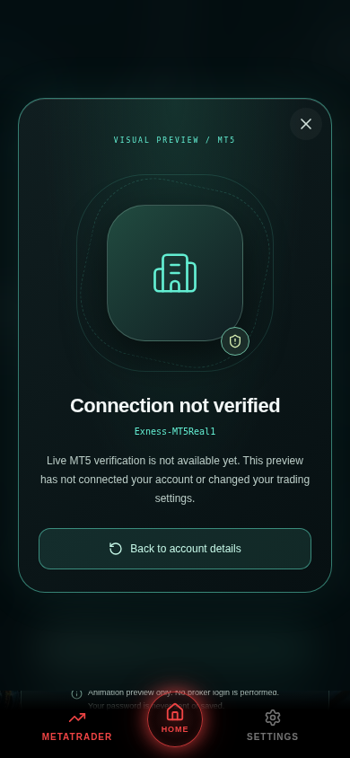

# MT5 Connections visual prototype

The real client app at `/ea-app/` now uses a glass and mint MT5 account screen over `useApp().bgImageUrl`. That value comes from the authenticated client's linked mentor in `/api/app/dashboard`; there is no hardcoded screen background. Missing/broken mentor images use the dark gradient surface. The existing navigation and mentor name remain in place.

**This change is a visual prototype, not an MT5 authentication implementation.** The Connect MT5 action plays a cancellable 3.2-second animation and always finishes at **Connection not verified**. The form, animation and outcome explicitly label this limitation. It never calls connect/disconnect endpoints, saves credentials, changes trading settings, or marks the account connected. Use a demo password. The password is cleared when the preview begins, closes, or the user leaves the tab.

Existing saved account details are read from the unchanged `/api/app/trading-controls` endpoint and labelled unverified. A stored historical `mt5Connected` flag is not presented as proof of a live connection. Existing records are never disconnected, deleted, reassigned or rewritten by this screen. API implementations, licensing/authentication, schema, database and trading code are unchanged.

## Visual review before deployment

These screenshots show the actual React app in Chromium at 390 × 844. The local browser test supplies isolated authentication/mentor fixtures and uses the repository's existing robot image as the fixture mentor upload. They do not show a production user's account. The broker requests are deliberately blocked in this test to exercise the neutral logo fallback.

| Account screen | Connection animation / fallback | Honest outcome |
| --- | --- | --- |
|  |  |  |

Nothing has been deployed or merged. Approve the visual design before deploying the existing Pages project. No database migration, seed, schema push, new service or runtime secret is required.

## Broker identities and logo provenance

`src/lib/brokers.ts` uses an explicit allowlist of HTTPS image assets. Only recognised broker prefixes and common server suffixes match; arbitrary substring matches and URLs remain unknown. Server recognition is a visual hint, never broker identity verification. Datalist values are examples, not a live server directory.

The logo images are authentic brand assets/site icons, not generated artwork. They are loaded as images, never as scripts, without a referrer, and without including account numbers, passwords or server text in asset requests. Unknown brokers, image errors and slow image loads use the neutral building icon. No paid logo API or new service is used.

| Broker | Asset source | Provenance |
| --- | --- | --- |
| Exness | `https://www.exness.com/static/apple-icon.png` | Official site icon; [official media resources](https://www.exness.com/exness-in-the-media/) |
| Deriv | `https://deriv.com/favicon.ico` | [Official broker website](https://deriv.com/) |
| IC Markets | Commons original: `IC Markets logo main.gif` | [Asset description and attribution](https://commons.wikimedia.org/wiki/File:IC_Markets_logo_main.gif) |
| Pepperstone | Commons original: `Pepperstone.svg` | [Official website source credited by Commons](https://commons.wikimedia.org/wiki/File:Pepperstone.svg) |
| XM | Commons original: `XM-logo-2024.jpg` | [Asset description and attribution](https://commons.wikimedia.org/wiki/File:XM-logo-2024.jpg) |
| HFM | Official `static.grouphfm.com` black-version SVG | [Official brand guidelines and original logo](https://affiliates.grouphfm.com/en/brand-guidelines) |
| FBS | `https://fbs.com/favicon.ico` | [Official broker website](https://fbs.com/) |
| Tickmill | `https://www.tickmill.com/favicon.ico` | [Official broker website](https://www.tickmill.com/) |
| FXTM | Commons original: `FXTM logo.svg` | [Official ForexTime source credited by Commons](https://commons.wikimedia.org/wiki/File:FXTM_logo.svg) |
| OANDA | `https://www.oanda.com/favicon.ico` | [Official broker website](https://www.oanda.com/) |
| AvaTrade | `https://www.avatrade.com/favicon.ico` | [Official broker website](https://www.avatrade.com/) |

Sources were researched on 21 October 2026. Broker-hosted favicons and Commons redirects can change or be blocked by CSP/hotlink policies; the fallback is intentional. Official Exness image and HFM logo links were resolved using web research. Several ICO/SVG responses cannot be rendered by the research tool; these assets need a staging browser availability check before deployment. The isolated browser suite verifies loaded-image behavior separately from network-failure fallback and does not certify third-party asset uptime. Logos are used only to identify brokers; no affiliation or endorsement is implied. The application does not recolor, redraw or generate broker marks.

## Future backend integration boundary

`src/lib/mt5-preview.ts` deliberately accepts only a login/server hint and an AbortSignal. Its result type can represent only `unverified`; it accepts no password or auth token and performs no fetch/storage calls. Do not change the simulated delay into a success flag.

A future separately reviewed verification adapter must authenticate the client against the existing API, require explicit server-side broker verification, handle cancellation/timeouts and surface a verified result only with authoritative evidence. Do not treat HTTP 200, existing saved connection flags or a matching broker name as proof of a live session. Review secure credential handling before adding credentials to that interface. This patch leaves every backend endpoint unchanged.

## Checks

- TypeScript project/library build plus ea-app, ea-cloud and api-server checks.
- Mobile and website Vite production builds and combined Pages routing verification.
- Node tests for detection (including legacy/regional aliases, unknowns and spoofed strings), account validation, finite unverified completion and cancellation; existing loading, Pages, storage and bootstrap unit suites.
- Browser checks at 390 × 844, 320 × 568 and 1280 × 900: linked mentor background, saved account preservation, password toggle/clearing, invalid account numbers, known/unknown brokers, image fallback, honest completion, cancellation, tab cleanup, reduced motion, focus trapping/restoration, no horizontal overflow, no write requests and no runtime errors.

Run from repository root:

```sh
node --test --test-isolation=none scripts/tests/mt5-preview.test.mjs scripts/tests/mobile-loading.test.mjs scripts/tests/pages.test.mjs scripts/tests/background-storage.test.mjs scripts/tests/bootstrap.test.mjs
pnpm run typecheck
pnpm run build:pages
```

The browser script requires a local Vite ea-app server mounted at `/ea-app/`, Playwright and Chromium. It refuses non-loopback origins, mocks every API response, and never uses production credentials. Set `PLAYWRIGHT_MODULE` to an installed Playwright module URL if it is not in the project's module resolution; set `CHROMIUM_PATH` for another Chromium installation. Set `MT5_PREVIEW_ORIGIN` for a different loopback port.

```sh
BASE_PATH=/ea-app/ pnpm --filter @workspace/ea-app dev
# In another terminal with Playwright installed:
node scripts/tests/mt5-preview.browser.mjs
```

After design approval, use the existing Pages `pnpm run build:pages` pipeline/output (`artifacts/ea-cloud/dist`). Preserve current API/R2 settings and data. Smoke-test with a licensed staging client and its mentor background, then verify third-party logos under the deployment's actual CSP. No backend deployment is needed for this frontend-only change.
