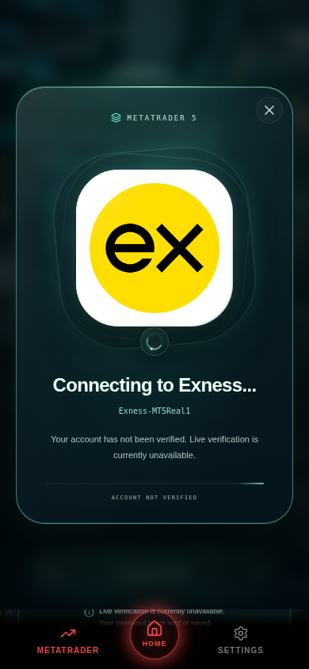

# MT5 Connections visual prototype

The real client app at `/ea-app/` now uses a dark translucent glass MT5 account screen with turquoise edges, soft reflections and lighting over `useApp().bgImageUrl`. That value comes from the authenticated client's linked mentor in `/api/app/dashboard`; there is no hardcoded screen background. Missing/broken mentor images use the dark gradient surface. The existing navigation and mentor name remain in place.

**This change is a visual prototype, not an MT5 authentication implementation.** The Connect MT5 action plays a cancellable 3.2-second animation and always finishes at **Live verification unavailable**. The form contains a quiet availability note, and the final message explicitly confirms the account has not been connected. Prominent development labels ("Visual Preview", "Demo Connection" and similar) are not part of the product UI. It never calls connect/disconnect endpoints, saves credentials, changes trading settings, or marks the account connected. Use a demo password. The password is cleared when the preview begins, closes, or the user leaves the tab.

Existing saved account details are read from the unchanged `/api/app/trading-controls` endpoint and labelled unverified. A stored historical `mt5Connected` flag is not presented as proof of a live connection. Existing records are never disconnected, deleted, reassigned or rewritten by this screen. API implementations, licensing/authentication, schema, database and trading code are unchanged.

## Visual review before deployment

These screenshots show the actual React app in Chromium at 390 × 844. The local browser test supplies isolated authentication/mentor fixtures and uses the repository's existing robot image as the fixture mentor upload. They do not show a production user's account. All third-party requests are deliberately blocked. Recognised brokers still render their real bundled logos; only unknown brokers use the neutral icon.

| Account screen | Connection animation / real Exness logo | Honest outcome |
| --- | --- | --- |
|  |  |  |

The latest glass and animation refinement is for visual approval; this task has not merged or deployed it. Approve the updated visual design before deploying the existing Pages project. No database migration, seed, schema push, new service or runtime secret is required.

## Broker identities and logo provenance

`src/lib/brokers.ts` uses static references to 11 authentic logo files in `src/assets/brokers/`. Vite bundles/embeds them under the app's configured base path. No broker image requests go to external websites, favicons, Commons redirects, logo APIs or paid services. Broker detection remains a name hint, never identity verification; the recognised prefixes and server examples are unchanged.

Exness, Deriv, XM, IC Markets, Pepperstone, HFM, FBS, Tickmill, FXTM, OANDA and AvaTrade each have their own real local logo. Only unknown brokers display the building fallback. An unexpected local asset error is explicitly labelled with the recognised broker name and a retry option rather than substituting a generic icon. The app does not recolour or redraw broker marks. Light-colour marks receive a dark backing inside the same logo tile so they remain readable.

See [pinned asset provenance, attribution and licence notes](../artifacts/ea-app/src/assets/brokers/README.md) and the [SHA-256 manifest](../artifacts/ea-app/src/assets/brokers/manifest.json). The real files, not test substitutes, are decoded in Chromium with third-party access blocked, including an Exness animation screenshot and separate Deriv/XM/IC Markets captures. Broker images are no longer a deployment-time third-party availability dependency.

## Glass connection animation

The connection panel is a translucent glass surface over the mentor-branded screen, with restrained turquoise edge lighting, soft reflections and a blurred backdrop. The original bundled broker artwork remains unchanged. Its larger rounded-square tile fades and grows into view over 1.65 seconds, with a small circular spinner and rotating glow beneath it. The spinner runs only in the `connecting` state; the final unavailable state stops it.

The visual phase is exposed through `data-state` and remains separate from the cancellable adapter result. There is no successful state in this adapter. Future real backend results can drive the existing presentation without using the animation's completion as proof of authentication. Reduced-motion users see the complete logo immediately, without the entrance, pulse, rotation or progress animation. Closing or leaving the tab still cancels the pending attempt and clears the password.

## Future backend integration boundary

`src/lib/mt5-preview.ts` deliberately accepts only a login/server hint and an AbortSignal. Its result type can represent only `unverified`; it accepts no password or auth token and performs no fetch/storage calls. Do not change the simulated delay into a success flag.

A future separately reviewed verification adapter must authenticate the client against the existing API, require explicit server-side broker verification, handle cancellation/timeouts and surface a verified result only with authoritative evidence. Do not treat HTTP 200, existing saved connection flags or a matching broker name as proof of a live session. Review secure credential handling before adding credentials to that interface. This patch leaves every backend endpoint unchanged.

## Checks

- TypeScript project/library build plus ea-app, ea-cloud and api-server checks.
- Mobile and website Vite production builds and combined Pages routing verification.
- Node tests for detection (including legacy/regional aliases, unknowns and spoofed strings), account validation, finite unverified completion and cancellation; existing loading, Pages, storage and bootstrap unit suites.
- Browser checks at 390 × 844, 320 × 568 and 1280 × 900: linked mentor background, saved account preservation, password toggle/clearing, invalid account numbers, known/unknown brokers, real local logo rendering and unknown-only fallback, logo fade/scale and rotating spinner, absence of development labels, honest unavailable completion, cancellation, tab cleanup, reduced motion, focus trapping/restoration, no horizontal overflow, no write requests and no runtime errors.

Run from repository root:

```sh
node --test --test-isolation=none scripts/tests/mt5-preview.test.mjs scripts/tests/mobile-loading.test.mjs scripts/tests/pages.test.mjs scripts/tests/background-storage.test.mjs scripts/tests/bootstrap.test.mjs
pnpm run typecheck
pnpm run build:pages
```

The browser script requires a local Vite ea-app server mounted at `/ea-app/`, Playwright and Chromium. It refuses non-loopback origins, mocks every API response, and never uses production credentials. Set `PLAYWRIGHT_MODULE` to an installed Playwright module URL if it is not in the project's module resolution; set `CHROMIUM_PATH` for another Chromium installation. Set `MT5_PREVIEW_ORIGIN` for a different loopback port.

```sh
BASE_PATH=/ea-app/ pnpm --filter @workspace/ea-app dev
# In another terminal with Playwright installed:
node scripts/tests/mt5-preview.browser.mjs
```

After design approval, use the existing Pages `pnpm run build:pages` pipeline/output (`artifacts/ea-cloud/dist`). Preserve current API/R2 settings and data. Smoke-test with a licensed staging client and its mentor background, and verify the bundled logo assets are served with the app. No backend deployment is needed for this frontend-only change.
