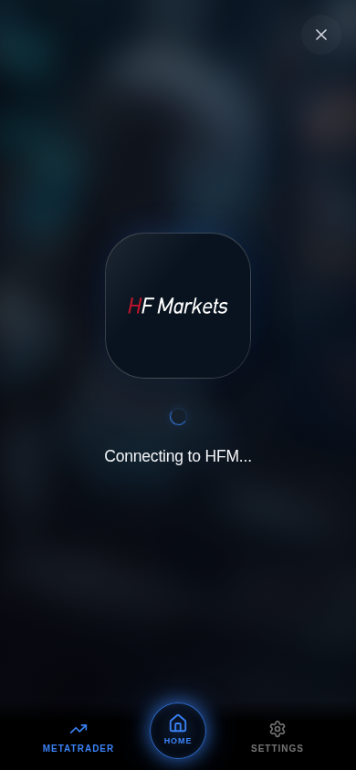
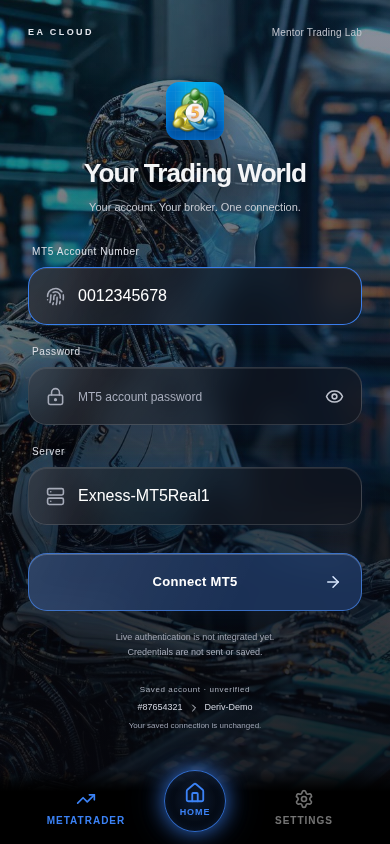

# MT5 Connections visual review — Draft PR #8

The actual React client at `/ea-app/` uses three independent floating glass fields and a separate Connect MT5 button. There is no outer form card or surrounding connection panel. The original full-colour MetaTrader 5 app icon replaces the stacked-layers icon above “Your Trading World”. Account validation, password visibility, broker hints, navigation and saved account restoration remain available.

All accent lighting comes from the existing `AppContext.accentColor`: field focus, glow, button, ambient lighting and spinner. Broker artwork is never recoloured. The login background comes directly from the authenticated client's `useApp().bgImageUrl`, which is supplied by the linked mentor dashboard data. The same image remains throughout the connection flow, with cover cropping, gradually increased blur and darkness. No background is hardcoded in the screen.

## Updated mobile screenshots

These are actual production-build Chromium captures at 390 × 844, not generated mockups. The isolated browser harness supplies authentication/account/dashboard fixtures; the existing robot image represents that fixture mentor's uploaded background. No production account or database is used. The blue theme is selected through the existing Settings interface.

| Login, red theme | Connecting to Exness |
| --- | --- |
|  |  |

| Connecting to HFM, blue theme | Login, blue theme |
| --- | --- |
|  |  |


## Connection behaviour and integration boundary

The connection animation contains one rounded-square broker block, one small theme-coloured spinner and “Connecting to [Broker]...”. Unknown servers use only the neutral fallback and exact “Connecting to broker...”. There are no percentages, invented stages, server details or development banners. A small cancel control and the existing navigation remain accessible.

The logo fades in, gently scales up and then floats subtly without rotating. The spinner rotates; reduced-motion users see the complete artwork immediately without animation. The backdrop transitions to a strongly blurred version of the same mentor image.

**Live MT5 authentication is not integrated.** A quiet login disclosure states that credentials are not sent or saved. The cancellable 3.2-second adapter always ends unverified with exact heading **“Backend not reachable right now.”**, followed by explicit clarification that no broker login was performed. That message appears only after the animation. Retry repeats the unverified animation; Back to login or Escape cancels it and restores focus. The password clears when the attempt starts, closes, or the user leaves the tab. No connect/disconnect request, fake balance or connected status is produced.

`src/lib/mt5-preview.ts` accepts only a login/server hint and AbortSignal, never a password or auth token. It performs no fetch or storage calls and can return only `unverified`. A separately reviewed real verification adapter can later drive these presentation states. A timer, matching broker name, historical saved flag or HTTP 200 must never substitute for authoritative backend verification.

Existing saved login/server details use the unchanged read-only `/api/app/trading-controls` request and remain labelled unverified. Records are never disconnected, deleted, reassigned or rewritten by this screen. No API, authentication, licensing, trading, schema, database, R2 or deployment configuration is changed.

## Authentic bundled artwork

The existing broker detection rules and eleven supported brokers remain: Exness, Deriv, XM, IC Markets, Pepperstone, HFM, FBS, Tickmill, FXTM, OANDA and AvaTrade. Recognised brokers always use their real local assets. HFM's former 32-pixel favicon is replaced by an original scalable HF Markets wordmark; its geometry and colours are preserved. Dark backing is retained where light artwork needs contrast; no default white backing is imposed. Known-logo loading errors offer explicit retry rather than the unknown-broker icon.

See [broker provenance and attribution](../artifacts/ea-app/src/assets/brokers/README.md), [broker SHA-256 manifest](../artifacts/ea-app/src/assets/brokers/manifest.json) and [MT5 artwork provenance](../artifacts/ea-app/src/assets/platform/README.md). Public packaging mirrors are identified honestly in those notes rather than claimed as direct official downloads. All image assets ship with the app; no third-party logo service or paid service is needed.

## Validation

- **30 Node tests passed:** broker matching, unknowns/spoofing, validation, exact asset hashes and PNG/SVG safety, original MT5 PNG, bounded unverified result/cancellation, and existing mobile loading, Pages, background storage and bootstrap suites.
- **TypeScript passed:** library project build plus ea-app, ea-cloud, api-server and scripts checks.
- **Production builds passed:** mobile app, website and combined Pages output verification for `/` and `/ea-app/`.
- **Production-browser checks passed:** all eleven authentic broker images decode with third-party requests blocked; actual Settings theme switching; no enclosing panels/layers icon; password toggle/clearing; validation; same mentor image/stronger blur; entrance fade/scale and themed spinner; exact final wording/retry; unknown fallback; cancellation and tab cleanup; focus trap/restoration including Retry; reduced motion; 320 × 568, 390 × 844, keyboard-height 390 × 420 and 1280 × 900 layouts; no overflow, write requests, third-party images, runtime or unexpected console errors. Authentication APIs and the existing account-update socket are isolated by fixtures.

Normal repository commands:

```sh
node --test --test-isolation=none scripts/tests/mt5-preview.test.mjs scripts/tests/mobile-loading.test.mjs scripts/tests/pages.test.mjs scripts/tests/background-storage.test.mjs scripts/tests/bootstrap.test.mjs
pnpm run typecheck
pnpm run build:pages
```

In this workspace the pnpm automatic dependency check attempted to reinstall already-present modules and could not create its home cache. Checks used the installed TypeScript binaries directly; the combined Pages build used `pnpm_config_verify_deps_before_run=false pnpm run build:pages` to avoid reinstalling dependencies. No manifest or lockfile changes are needed.

Browser reproduction requires a local production ea-app preview at `/ea-app/`, Playwright and Chromium. It refuses non-loopback origins, fixtures every API/account socket and blocks third-party requests. Set `PLAYWRIGHT_MODULE`, `CHROMIUM_PATH`, `MT5_PREVIEW_ORIGIN` and optionally `MT5_SCREENSHOTS` for local paths/ports, then run `node scripts/tests/mt5-preview.browser.mjs`. Screenshots use fixture credentials only.

## Approval and deployment

The revision commit uses the documented `[skip ci]` prefix to suppress Cloudflare Pages automatic deployment while updating the PR. Keep existing PR #8 in Draft. This revision is for visual approval only: **do not merge or deploy before approval**. No migration, schema push, seed, new environment variable, new service or backend deployment is required. After approval, use the existing Pages build/output (`artifacts/ea-cloud/dist`) and preserve all current API/R2 settings and records. A licensed staging-client smoke test with a real linked mentor background remains appropriate before any later approved production rollout. Live broker authentication remains a future integration, not a delivered capability.
