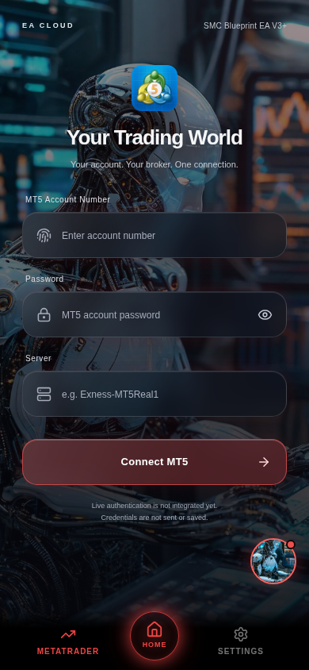
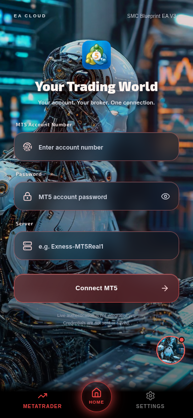

# MetaTrader 5 brightness and typography polish

The only application file changed is `artifacts/ea-app/src/pages/MetaTraderTab.css`. No JSX, input configuration, logo asset, connection logic, backend, navigation, floating robot or application font preference was changed.

The idle connection form uses the same mentor background URL, with opacity increasing from .78 to .98, mild saturation and a lighter overlay gradient. The existing connecting/unverified background rules are preserved. The main heading uses the already bundled Exo 2 at weight 900 with warm-white lettering and a restrained accent glow. Labels use the same existing font at 600; subtitle and input typography use the bundled Inter at 600, with brighter silver text and subtle accent borders/icons. Spacing, font sizes, field dimensions, corners and icons remain in place. No dependency or external font service was added.

The MT5 platform logo rules, Connect button rules, accent variables and disclaimer rules/wording are unchanged.

## Before and after





Captures use isolated account APIs and the existing default robot asset supplied as fixture mentor artwork. The user's original mentor image URL remains untouched. The reference images mentioned in the pasted request were not available, so no exact reference-image comparison is claimed.

## Verification

The real combined Cloudflare production output was served locally at `/ea-app/`. Before/after captures at 320×740, 390×844, 430×932 and 1024×900 confirmed matching x/y/width/height (within one CSS pixel) for branding row, logo, heading, subtitle, all three inputs, Connect button and disclaimer. Computed logo and Connect button appearance properties match exactly; heading overflow checks pass. The same image URL is used before and after. In the 390px capture, a representative background-only strip (x=2..16, y=65..740) has weighted screenshot RGB luma increasing from 31.69 to 53.65, corroborating the visible brightness difference.

[Recorded before/after measurements](measurements.json)

The existing MT5 browser suite also passed: password reveal/hide, account validation, credential clearing, connecting/unverified preview states and disclaimer, retry/cancel/focus behavior, broker assets, theme switching, navigation, reduced motion, small-phone/keyboard-height/desktop layouts, and no backend writes or runtime errors. These tests preserve the existing unverified preview behavior; they do not assert real MT5 authentication. All seven MT5 unit tests and TypeScript/production builds passed.

Repeat against a local production preview at port 5182:

```sh
MT5_VISUAL_STAGE=after MT5_PREVIEW_ORIGIN=http://127.0.0.1:5182 CHROMIUM_PATH=/usr/bin/chromium node scripts/tests/mt5-visual.browser.mjs
MT5_PREVIEW_ORIGIN=http://127.0.0.1:5182 node scripts/tests/mt5-preview.browser.mjs
node scripts/tests/mt5-preview.test.mjs
```

Set PLAYWRIGHT_MODULE to the external Playwright index.mjs path when needed. To capture a new baseline on the original source, use MT5_VISUAL_STAGE=before; the after stage uses that local baseline when available, otherwise these committed baseline measurements. Captures default to work/mt5-visual.

No production deployment was performed. These are locally verified production-build screenshots, not a live Cloudflare rollout.
