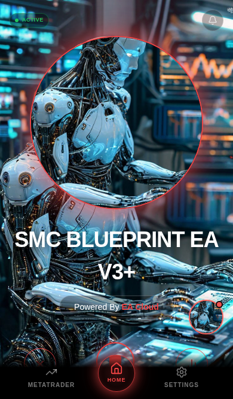
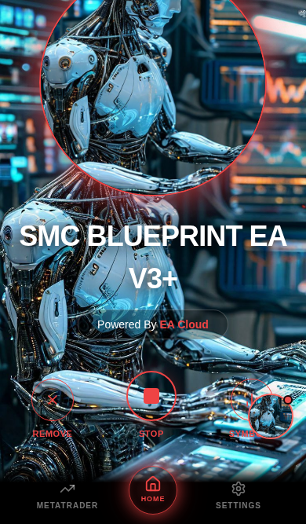

# Regular Interface header scrolling

The non-Matrix top bar used `position: sticky; top: 0`. In Regular mode it now uses normal relative positioning inside the existing scroll container, with 16px side spacing and safe-area-aware top spacing. The status and notification bell retain their handlers and share the same vertically centered row. Only Regular mode omits the center tagline (the top branding instance); the lower Powered By EA Cloud pill and other layouts are unchanged.

## Actual browser verification

Chromium tests used isolated API fixtures and the existing Settings UI to select Regular Interface. The reference screenshots mentioned in the request were not present in the supplied files; placement follows the written left/right alignment requirements. Captures use the existing default robot asset as mentor background, not a changed application asset.

At 320×568 and 390×667, a real 100px mouse-wheel scroll moved both controls upward by exactly 100px. At 430×740, content reached its natural 89px scroll limit and both controls moved upward by exactly 89px. All three verified matching vertical centers, 16px left/right spacing, green ACTIVE status, no top branding, and exactly one unchanged lower branding pill.

The notification bell opened Copied Trades; Stop/Start changed ACTIVE/PAUSED and issued the expected fixture requests; Remove opened its confirmation and Cancel closed it; Symbols opened its existing panel. No live trading requests were made.





[Recorded position measurements](browser-results.json)

Run the existing trading-app dev server, then:

```sh
CHROMIUM_PATH=/usr/bin/chromium node scripts/tests/regular-header.browser.mjs
```

If Playwright is installed externally, set PLAYWRIGHT_MODULE to its index.mjs path. Tests default to http://127.0.0.1:5174/ (override with APP_ORIGIN); screenshots and measurements are saved under work/regular-header. Type checking and production build also passed. No deployment was performed.
