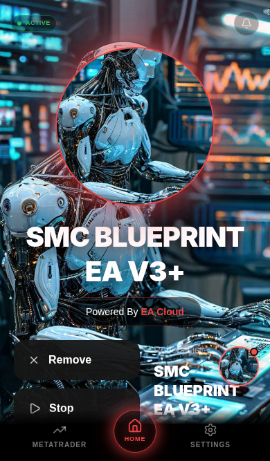
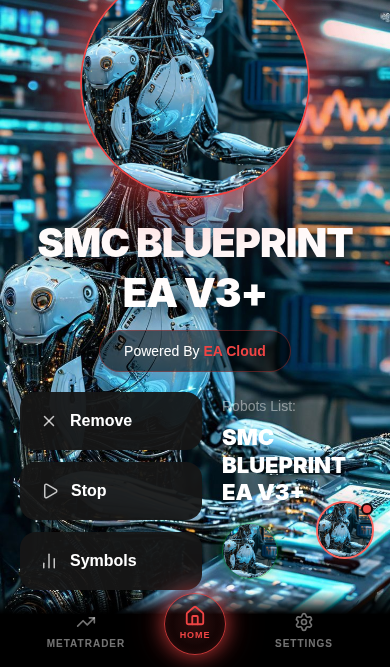

# S2tone_ header and duplicate top branding

## Actual rendering path and cause

`artifacts/ea-app/src/pages/HomeTab.tsx` selects `S2ToneLayout` when `interfaceStyle === "s2tone"`, the value selected by Settings → Select Main Interface → S2tone_. The ACTIVE indicator and notification bell are in HomeTab's shared non-Matrix header. S2tone inherited `sticky top-0` and 52px top padding, while Regular already had normal positioning. This kept S2tone's controls pinned during content scrolling.

The two top text instances were the shared header's `eaTagline` paragraph and S2ToneLayout's tagline button immediately above the robot frame. Both containers are removed. The separate Powered By EA Cloud pill below the bot title remains unchanged. The non-Matrix header now has normal relative positioning and equal 16px side spacing with safe-area-aware top padding. Regular's resulting header appearance and behavior are unchanged; Matrix uses its own header. No global CSS overrides or artwork changes are involved.

## Production-build browser verification

Built using the real combined Pages build (`pnpm --filter @workspace/ea-cloud build`), served that output locally, and opened `/ea-app/`. Chromium selected the actual S2tone_ interface through Settings. API calls were isolated fixtures; captures use the existing default robot image supplied as fixture mentor artwork. The user's custom background is not changed by the code.

At 320×568, 390×667 and 430×740, real browser wheel input scrolled the content 100px. Both header controls moved upward by exactly 100px, maintained equal 16px side margins and matching vertical centers, and no longer stayed attached to the viewport. Assertions confirmed that both top tagline paragraphs were absent, one lower branding pill remained, and ACTIVE stayed green. The bell opened Copied Trades. Stop/Start updated PAUSED/ACTIVE and issued the two expected fixture requests; Remove opened its confirmation; Symbols opened its panel.





[Recorded measurements](browser-results.json)

The Regular Interface's existing three-size browser regression also passed against the same production output. RegularLayout and MatrixLayout function bodies match the base branch exactly. TypeScript and combined production builds passed.

Repeat with a local production preview on port 5176 and an installed Playwright/Chromium:

```sh
APP_ORIGIN=http://127.0.0.1:5176/ea-app/ CHROMIUM_PATH=/usr/bin/chromium node scripts/tests/s2tone-header.browser.mjs
```

Set PLAYWRIGHT_MODULE to the installed module's absolute index.mjs path if it is outside the repository. No new application dependency was added.

## Deployment status

This fix is prepared on its own GitHub branch. No production deployment was performed. Previous live-origin inspection was blocked by the workspace egress proxy before reaching Cloudflare, so these screenshots establish the locally served production artifact, not the live website. The positioning reference screenshots were not supplied; alignment follows the written requirements.
