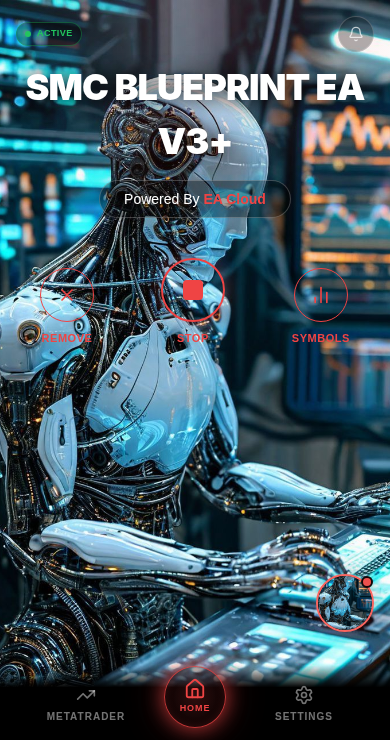
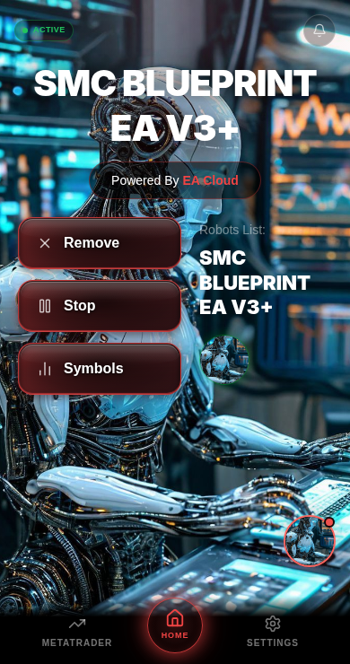
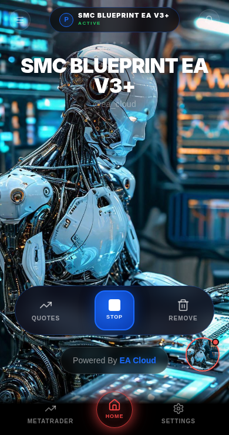
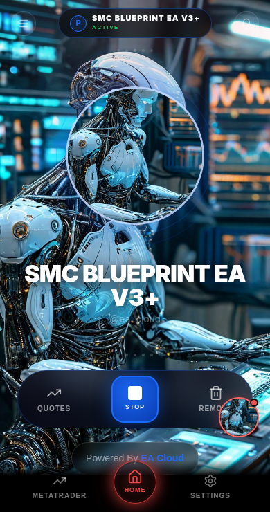
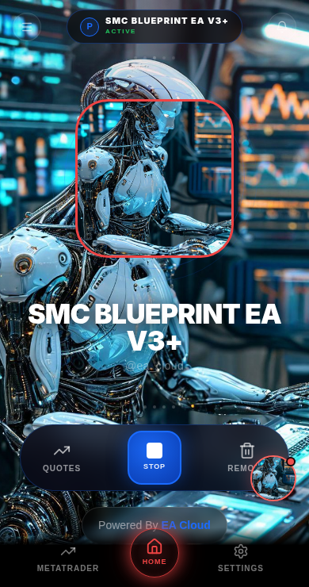

# Revised None visibility and Matrix sizing

## Current behavior

None now hides the main bot portrait and its complete frame in Regular, S2tone_ and Matrix, superseding the previous request to retain the image. RobotImageFrame returns null: there is no image, fallback, frame, transparent placeholder or reserved frame-sized DOM element. Existing frame-related glow, rings and pulses also remain absent. The interface's full background image, title, trading controls, navigation and independent trade-activity button are untouched. The None menu description reflects its new behavior.

Matrix's Orbit and Neural frames increase from 150px to 200px, with the existing surrounding holder increasing from 210px to 260px to retain the original 30px inset. Existing colors, borders and remaining layout are preserved. Regular's 290px and S2tone's 230px frames are unchanged. None still persists through the existing per-client preference store, and selecting another shape immediately restores its image and frame. Cornerstone and Fortress remain removed.

## Production-build browser verification

Served the combined Cloudflare Pages output locally at `/ea-app/`. Chromium selected each actual interface and shape via Settings, using isolated API fixtures and the existing default robot artwork as mentor background. None → Orbit → Neural → None was exercised in all three layouts, verifying immediate DOM updates before leaving Settings, a visible unchanged background, no portrait/frame DOM for None, restored images for the remaining choices, centered frames, and retained None selection after reload. All twelve transitions passed. Matrix frames measured exactly 200px; Regular and S2tone measured 290px and 230px.











[Browser measurements](browser-results.json)

Four unit tests also pass, covering all nine layout/shape combinations, menu callbacks, persistence, invalid legacy preferences, unavailable storage, and no fallback portrait in None mode. TypeScript and production builds passed.

```sh
APP_ORIGIN=http://127.0.0.1:5178/ea-app/ CHROMIUM_PATH=/usr/bin/chromium node scripts/tests/shape-selection.browser.mjs
node scripts/tests/robot-shape.test.mjs
```

For externally installed Playwright, set PLAYWRIGHT_MODULE to its index.mjs path. Captures default to work/shape-selection/.

## Pending requirement and deployment

The request ends mid-sentence at “Only the existing interface background imag”, and no reference image is available in the supplied files. The user confirmed that “Neutral” refers to the existing Neural option in the Shapes section. The reference-based Matrix Neural redesign has NOT been implemented: it requires the missing reference and remaining instructions. This is a verified partial change, not completion of all three requested changes.

No production deployment was performed. Live Cloudflare content has not been verified; screenshots establish the local production artifact only.
