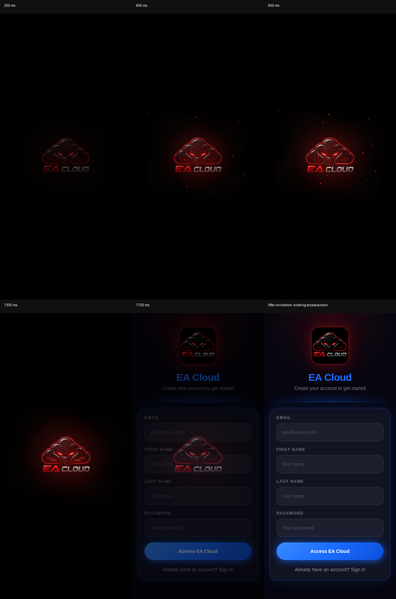

# Startup playback fix and browser verification

## Reproduced causes

- `/app` and `/app/dashboard` used the website bundle, which did not mount `StartupSplash`. The animation was only integrated into the separate trading app bundle at `/ea-app/`.
- The old component started its removal timeout at mount, independently of the logo download and CSS playback. With an image request delayed by 2.6 seconds, the mounted splash had `naturalWidth: 0` at 600 ms and was already gone at 2200 ms. Its CSS animations were running, but the logo had never appeared.
- Direct portal dashboard launches also redirected before persisted-session validation completed.

## Fix

Both client app entries mount the same cinematic component. Its finite CSS timeline stays paused until the existing logo decodes; one shared 2000 ms duration drives all effects. The splash completes on its own `animationend`, not a racing mount timeout or child animation event. Initialization runs concurrently. Readiness cannot shorten the sequence; slow initialization retains the completed mark without replay. An asset failure provides a retry instead of silently skipping playback. The original logo is unchanged, with presentation dimensions reduced to 75% of the previous startup dimensions. Neon contours, particles, glow and circuit traces have stronger visibility.

The portal dashboard waits for authentication validation and reports initialization readiness to the splash. Existing routes, tokens and trading controls are preserved. Other website routes do not acquire a splash. Reduced-motion users retain the two-second fade without moving particles or electrical effects.

## Browser evidence

Actual Chromium captures from the running development application, with deterministic API fixtures for authentication scenarios. No production service or deployment was used.



[`browser-results.json`](browser-results.json) records computed frame times, image dimensions, opacity, centering, electrical stroke offsets, sweep transforms, circuit illumination and native animation events.

Passed: guest, cold logo (2.6-second image delay), slow authentication, authentication failure, desktop, portal login, authenticated portal dashboard, reduced motion, and failed logo asset with retry. Eight playback scenarios each reported `animationend.elapsedTime === 2`. Each had five screenshots taken while its real animation advanced, without seeking or pausing the timeline. Authenticated trading-app navigation remained functional after startup and retained its session token. Portal dashboard reached the existing mentor interface.

## Repeat

Start both existing development servers:

```sh
pnpm --filter @workspace/ea-app dev
pnpm --filter @workspace/ea-cloud dev
```

With Playwright and Chromium available:

```sh
CHROMIUM_PATH=/usr/bin/chromium node scripts/tests/startup-animation.browser.mjs
```

If Playwright is installed outside the repository, set `PLAYWRIGHT_MODULE` to its absolute `index.mjs` path. The test introduces no application dependency. Captures and detailed measurements default to `work/startup-verification/`. `STARTUP_SCENARIOS` optionally selects comma-separated cases.

Both application bundles also pass TypeScript checking and production builds. Nothing was deployed.
