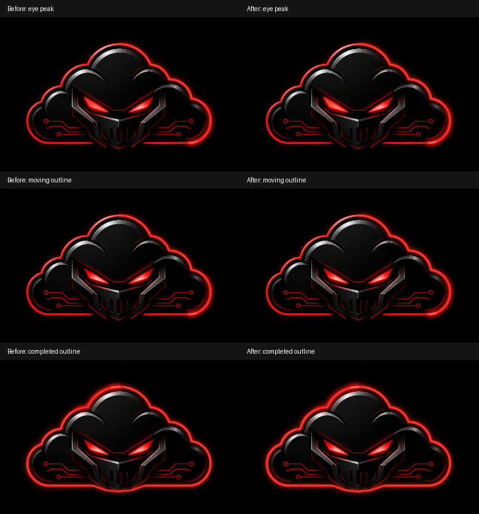

# Black launch configuration and half-length startup

## Recording investigation and limits

The new recording is 16.07 seconds at 30fps. Its first three seconds were
extracted frame by frame, including the native expansion around 1.3–1.7s.
No unambiguous full-screen white frame was present in the decoded frames.
The highest near-white pixel fraction before the app opened was about 1.46%,
primarily Spotlight text/icons. This does not disprove the reported flash:
a shorter native compositor frame or a separate cold/warm launch can differ.
The exact device-level source remains unconfirmed.

The document already had black HTML/body and a black manifest background.
The main application and loading overlay are black, and the existing touch
icon has black corners. There is no service worker in this app that injects
a separate white loading view. No Home/transition/authentication changes were
made to conceal the report.

Two native-launch configuration gaps were found: no explicit black theme
metadata and no Apple launch-image declarations. These are addressed as
supported configuration, not proof that native iOS has been fixed.

## Changes addressing white launch surfaces

- Initial document meta theme-color and manifest theme_color are #000000.
- Existing manifest background_color and inline HTML/body black are retained.
- Empty-root critical CSS explicitly paints black before React or global CSS.
- 24 solid-black PNGs cover portrait/landscape for 12 common iPhone screen/DPR
  profiles. Media-matched apple-touch-startup-image declarations supply them
  to the native launch phase, without another application loading screen.
- Existing status-bar style, icon artwork, standalone mode, app identity,
  scope and start URL are unchanged. No timers, artificial delays, additional
  animation stages or service worker were added for the flash.

Every generated PNG was decoded and verified to contain only black pixels
and to have the expected physical dimensions. The existing generator can
reproduce both the assets and matching link declarations:

    python3 scripts/generate-black-launch-images.py

The generator requires Pillow only as a development tool; there is no new
application dependency. Files total approximately 236KiB; declarations select
matching screen profiles rather than introducing JavaScript image downloads.
Unsupported screen profiles and cached native installation metadata still
require on-device checking. The OS decides how/when native launch assets or
previous snapshots are used.

## Halved loading duration, per the follow-up request

The ready-on-time sequence is now 4700ms instead of 9400ms:

| Phase | Duration |
| --- | --- |
| Existing centred entrance | 1000ms |
| Existing clockwise cloud trace | 3300ms |
| Completed outline | 100ms (unchanged) |
| Home crossfade | 300ms (unchanged) |

Eye cycles remain 2400ms/3100ms with the same independent offset/keyframes.
The original path, logo, size, position and Home transition code/CSS remain
unchanged. The entrance/trace timing changes are specifically authorized by
the subsequent request to cut loading time in half. If initialization is
late, readiness still prevents revealing an uninitialized application.

## Small intensity increase

The outline's existing near/wide bloom gains slightly stronger light and a
wider soft halo; the core line remains four artwork units wide. The leading
tip is slightly brighter. Eye halo gain/radius and core intensity increase
without changing eye shape, fill colours, opacity-cycle keyframes or timing.
Filter regions contain the full expanded blur extents; SVG overflow remains
visible.

These are actual 390px Chromium renders at the same normalized trace position,
not generated artwork. Pixel changes versus the baseline were verified for
eye, moving-outline and completed-outline frames. No logo pixels are edited.

## Tests and results

- 12 startup browser scenarios pass: guest, desktop, Android-sized viewport,
  simulated standalone, cold logo, delayed auth, auth error, portal, portal
  dashboard, reduced motion, asset failure and mid-entrance readiness.
- Ready-on-time sequences measure approximately 4.75–4.83 seconds locally.
  An intentionally delayed auth request still holds the loading overlay.
- The first-paint test blocks app modules and verifies black HTML/body/root,
  black theme/manifest hints, a matching launch-image media query, a visible
  loaded original logo and a single, stable React handoff.
- Those checks pass for fresh navigation and same-context browser reloads,
  in normal and reduced-motion modes. Browser reloads are not native iOS warm
  launch tests. Native cold/warm launches remain unverified.
- Three compiled-bundle startup scenarios pass (guest, standalone and portal
  dashboard), followed by the fresh/reloaded first-paint checks.
- Client/portal TypeScript checks and combined Pages production build pass.
- Exact comparisons confirm unchanged eye clocks/keyframes, cloud path,
  completion/crossfade constants and Home crossfade CSS.

The browser suite defaults to one foreground page at a time to avoid headless
background-frame throttling skipping a short 300ms transition. Optional
STARTUP_CONCURRENCY is intended for smoke runs, not frame measurements.
Existing Vite sourcemap/chunk-size warnings remain.

## Native limitations and sources

An actual iPhone was unavailable. No claim is made that desktop emulation
proves elimination of a native iOS flash. The updated app needs cold-launch
and previously-used/reopen testing on the affected installed iPhone app.
Existing installs may retain OS-managed launch metadata or snapshots.

Apple documents the launch-image link as the supported way to specify the
image used while a Home Screen web app launches. Theme/background values
are hints to the browser/OS; application CSS cannot draw a native pre-document
frame or guarantee how a particular iOS release handles stored snapshots.

- [Apple: configuring web applications and launch images](https://developer.apple.com/library/archive/documentation/AppleApplications/Reference/SafariWebContent/ConfiguringWebApplications/ConfiguringWebApplications.html)
- [MDN: manifest background_color](https://developer.mozilla.org/en-US/docs/Web/Progressive_web_apps/Manifest/Reference/background_color)
- [MDN: theme-color metadata](https://developer.mozilla.org/en-US/docs/Web/HTML/Reference/Elements/meta/name/theme-color)

## Exact files in this correction

- artifacts/ea-app/index.html
- artifacts/ea-app/public/manifest.webmanifest
- artifacts/ea-app/src/components/StartupSplash.tsx
- artifacts/ea-app/src/components/StartupSplash.css
- scripts/generate-black-launch-images.py
- scripts/tests/startup-animation.browser.mjs
- scripts/tests/startup-first-paint.browser.mjs
- scripts/tests/startup-light-visual.browser.mjs
- docs/cinematic-startup.md
- docs/startup-black-launch/README.md
- docs/startup-black-launch/glow-comparison.png
- artifacts/ea-app/public/launch/black-1125x2436.png
- artifacts/ea-app/public/launch/black-1136x640.png
- artifacts/ea-app/public/launch/black-1170x2532.png
- artifacts/ea-app/public/launch/black-1179x2556.png
- artifacts/ea-app/public/launch/black-1206x2622.png
- artifacts/ea-app/public/launch/black-1242x2208.png
- artifacts/ea-app/public/launch/black-1242x2688.png
- artifacts/ea-app/public/launch/black-1284x2778.png
- artifacts/ea-app/public/launch/black-1290x2796.png
- artifacts/ea-app/public/launch/black-1320x2868.png
- artifacts/ea-app/public/launch/black-1334x750.png
- artifacts/ea-app/public/launch/black-1792x828.png
- artifacts/ea-app/public/launch/black-2208x1242.png
- artifacts/ea-app/public/launch/black-2436x1125.png
- artifacts/ea-app/public/launch/black-2532x1170.png
- artifacts/ea-app/public/launch/black-2556x1179.png
- artifacts/ea-app/public/launch/black-2622x1206.png
- artifacts/ea-app/public/launch/black-2688x1242.png
- artifacts/ea-app/public/launch/black-2778x1284.png
- artifacts/ea-app/public/launch/black-2796x1290.png
- artifacts/ea-app/public/launch/black-2868x1320.png
- artifacts/ea-app/public/launch/black-640x1136.png
- artifacts/ea-app/public/launch/black-750x1334.png
- artifacts/ea-app/public/launch/black-828x1792.png
