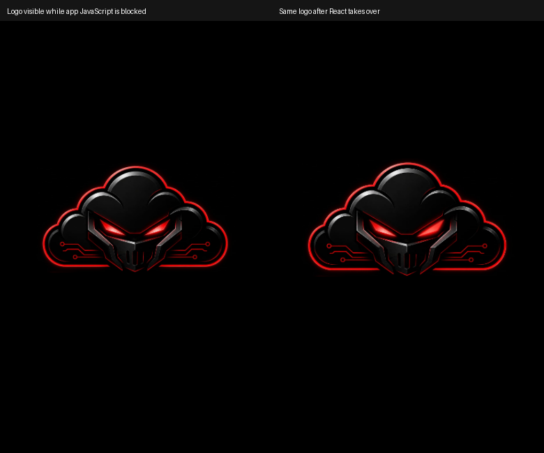
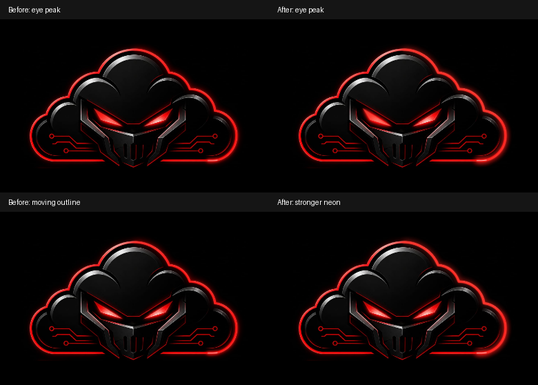

# Startup intensity and first-paint handoff

## New recording: what is established

The 8.5-second supplied iPhone recording shows Spotlight until roughly 3.0s,
iOS's native expansion around 3.0–3.3s, a black interval, and the application
logo appearing around 4.6s. Frame-by-frame inspection of 2.9–4.8s did not
establish a duplicate React logo, a Home flash or a distorted logo. A
brightness-amplified diagnostic revealed the outgoing Spotlight surface
under the native animation; those pixels belong to iOS, not an app component.
The video ends before the final Home transition.

The suspected interval was presented to the user for timestamp confirmation.
In the absence of a different timestamp, the targeted application defect is
the independently verified web-controlled blank first paint. We cannot
attribute the entire recorded black interval to React or claim a permanent
native-iPhone fix without a device retest.

## Targeted blank-paint correction

Previously the entry HTML had an empty root. The existing logo was introduced
only after the application bundle/CSS loaded and React mounted; its CSS opacity
also began at zero while image decoding was pending. Holding application
modules reproduces a black document with no logo.

The initial HTML now preloads and paints the exact same cropped JPEG via the
empty root's pseudo-element. This is an initial paint of the existing mark,
not another overlay, loading stage, timer or delay. `:empty` stops matching in
the same DOM commit that mounts React. Both use the same image URL, crop,
centred box and initial 0.88 scale. The existing two-second zoom remains; its
initial opacity is now 1 so taking over the already-visible logo cannot erase
it. Reduced-motion mode uses matching unscaled geometry on both sides.

The new public logo is a symlink to the unchanged original JPEG, not replacement
artwork. This lets the HTML preload/pseudo-element and React use a single
request. The built/copied JPEG bytes are identical to the source. The existing
portal public asset also supplies the shared component at the portal entry.

With application scripts intentionally blocked, the real JPEG renders before
React. After release, 16 consecutive frames in both normal/reduced-motion modes
show one visible loaded logo, centred geometry, opacity 1, and no remaining
pseudo-element. The same checks pass on the combined production build.

This fixes the tested web-controlled gap. It cannot paint before an HTML
response arrives or control iOS's native launch snapshot/expansion. Existing
black page/manifest configuration is retained; no speculative device-specific
launch assets, extra loading screen or service worker is introduced.

## Intensity-only light changes

The sharp red core stays 4 artwork units wide. A bounded SVG filter now combines
near and wide red bloom around the accumulating line, with a stronger soft
moving halo/tip. The reference is used only for neon brightness/spread: no
percentages, text, floor reflections or added interface elements are copied.

The eye halo combines two blur radii with increased light gain and a brighter
core. The opacity keyframes, 2.4s/3.1s cycles and right-eye offset are unchanged.
All blur/gain values are static; only the existing dash/opacity clocks animate.
Filter regions include the full blur extents, and SVG overflow stays visible.

These unboosted 390px-wide renders use identical frozen animation positions.
No original logo pixels were edited. Completed-outline captures were also
inspected for halo clipping.

## Checks

- 12 startup scenarios pass: guest, desktop, Android-sized viewport, simulated
  standalone, delayed logo, delayed authentication, auth failure, portal,
  portal dashboard, reduced motion, asset failure and mid-entrance readiness.
- Three compiled application checks pass: guest, standalone and portal dashboard.
- First-paint/module-blocking handoff passes in normal/reduced-motion modes,
  both on the dev server and the combined production build.
- Actual-logo dim/bright/moving/completed glow frames are captured and inspected.
- Client/portal TypeScript and combined Pages build pass.
- Exact invariants confirm unchanged eye cycles, path/direction, all duration
  constants, Home crossfade CSS and original JPEG bytes.

The existing 100ms completion and 300ms Home crossfade, easing and removal
logic are untouched. No Home, voice, authentication, navigation, trading or
settings components changed. Existing Vite sourcemap/chunk warnings remain.

Physical iPhone Safari/PWA hardware was unavailable. Chromium standalone
emulation does not verify native iOS launch behavior or exact screen luminance.
The reference's perceived brightness therefore still needs on-device acceptance.

Run with the two dev servers, or set STARTUP_APP_ORIGIN/STARTUP_PORTAL_ORIGIN
for the combined production build:

    node scripts/tests/startup-animation.browser.mjs
    node scripts/tests/startup-light-visual.browser.mjs
    node scripts/tests/startup-first-paint.browser.mjs

PLAYWRIGHT_MODULE may point to an installed Playwright module. The first-paint
script disables Playwright's font-readiness screenshot wait because it
intentionally blocks modules and the logo contains no text. This affects only
the test process, not the application.

## Files in this correction

- artifacts/ea-app/index.html
- artifacts/ea-app/public/ea-cloud-logo.jpeg (symlink to existing original)
- artifacts/ea-app/src/components/StartupSplash.tsx
- artifacts/ea-app/src/components/StartupSplash.css
- scripts/tests/startup-animation.browser.mjs
- scripts/tests/startup-light-visual.browser.mjs
- scripts/tests/startup-first-paint.browser.mjs
- docs/cinematic-startup.md (follow-up link)
- docs/startup-intensity/README.md
- docs/startup-intensity/glow-comparison.png
- docs/startup-intensity/first-paint.png
