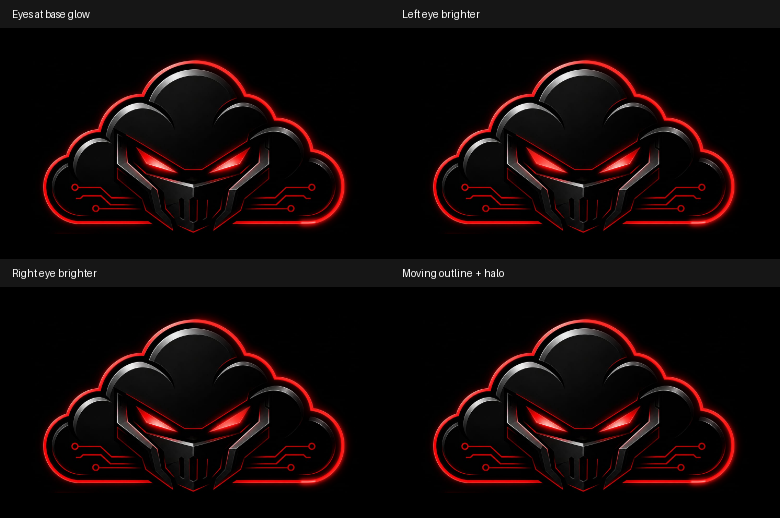

# Visible startup light — recording-based correction

The two-second entrance, seven-second clockwise trace, exact cloud path,
logo image/crop/size/position, 100ms completion and 300ms coordinated crossfade
are unchanged. No Home, trading, voice, navigation or authentication component
is modified.

## Recording inspection

The supplied 7.4-second iPhone recording was extracted at 30fps around the
entrance and inspected frame by frame. Around 3.4–3.7s it shows the native iOS
app expansion from App Library into a black launch surface. The logo entrance
begins around 4.9s. The recording ends during startup at 7.4s; it does not show
Home or the final crossfade. No isolated application flash or duplicate logo
was established in these frames. Native launch snapshots/zoom transitions are
controlled by iOS and cannot be removed by React. We do not claim the timing
bug below is definitively the user's recorded glitch.

## Corrections and pixel verification

The old eye overlays were faint over already bright/saturated embedded eye
pixels. SVG CSS drop-shadows also left the moving halo visually weak. The
corrected eyes have separate feathered light and core layers; each is a group
with its own 2.4s/3.1s opacity clock and the existing right-eye phase offset.
The original JPEG is unchanged. The two lights never turn off, and reduced
motion retains quiet static illumination.

The moving red trail and leading tip now have explicit SVG Gaussian-blur
layers with bounded user-space filter regions and sRGB interpolation. The
sharp line retains its original width, path, direction and speed. No SVG
CSS blend-mode dependency is needed for these new light layers. Filter blur
values remain static; only the existing dash offsets and eye opacity animate.

These are actual Chromium renders at a 390px viewport. Only CSS animation
clocks are paused for matched frames; the source image is not altered. Pixel
comparison results against matched dim/halo-disabled frames:

| Effect | Peak channel difference (0–255) | Pixels differing by at least 12 |
| --- | --- | --- |
| Left eye | 68 | 336 |
| Right eye | 66 | 335 |
| Moving halo | 71 | 568 |

Each eye's changed pixels are confined to its own eye region. The other eye
and logo remain unchanged. The halo comparison changes pixels outside the
sharp moving line, establishing a rendered glow rather than a colour-only
change. The evidence image shows natural intensity; it is not contrast boosted.

## Reproduced application timing defect

The startup phase timer depended directly on `ready`. Authentication/data
readiness changing during the two-second CSS entrance reset the JavaScript
timer, although CSS continued uninterrupted. With readiness arriving 1.2s
into launch, the original phase took 3376.8ms to enter tracing; the corrected
phase took 2001.3ms. This mismatch could leave a settled, apparently static
logo awaiting a restarted clock. The timer now observes readiness only in the
completion phase that needs it. Readiness still gates revealing Home.
No delay is added and no crossfade duration/easing/removal behavior is changed.

## Completed checks

All 12 startup browser scenarios pass, including the new mid-entrance readiness
regression, along with three compiled-app scenarios (guest, standalone and
mid-entrance readiness). The matched-frame light captures also pass against
the compiled bundle with the same pixel differences reported above. Both
frontends pass TypeScript checks and the combined Pages production build.

## Reproduction

Run both local dev servers, then:

    PLAYWRIGHT_MODULE=/path/to/playwright/index.mjs node scripts/tests/startup-animation.browser.mjs
    PLAYWRIGHT_MODULE=/path/to/playwright/index.mjs node scripts/tests/startup-light-visual.browser.mjs

Both scripts support STARTUP_APP_ORIGIN for a locally served production bundle.
The main regression also supports STARTUP_PORTAL_ORIGIN and STARTUP_SCENARIOS.
Screenshots and measured results are written under work/ by default.

Native iPhone Safari/PWA hardware was unavailable. Chromium mobile and
standalone emulation does not establish native WebKit verification. SVG blur
filters and explicit bounds use supported SVG primitives, but on-device
acceptance is still needed. Local API fixtures do not submit trades or modify
production accounts. Existing Vite label sourcemap/chunk-size warnings remain.
